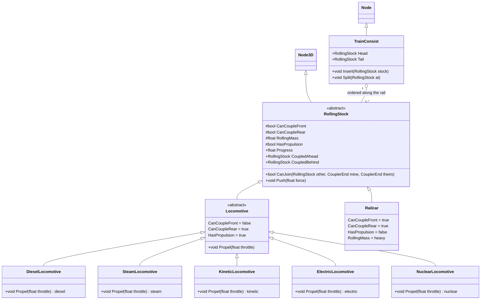

# Rolling stock

`RollingStock` is the shared base for every locomotive and railcar. A caboose is a `Railcar` with `CanCoupleRear` set to false. `TrainConsist` is a `Node` that owns one chain and steps it along the rail. It stores references to its `RollingStock` members and does not parent them. A lone railcar is a `TrainConsist` with one member.

`RollingStock` implements the coupler flags, mass, propulsion flag, rail progress, neighbor links, pushing, and `CanJoin`. `CanJoin` succeeds when both facing ends have a coupler.

`Locomotive` implements a closed front coupler, an open rear coupler, and propulsion. Diesel, steam, kinetic, electric, and nuclear each implement `Propel` for that power source.

`Railcar` implements an open front coupler, a configurable rear coupler, no propulsion, and high mass. It has no subclasses.

`TrainConsist` sums member mass, applies locomotive or push force, and advances every member by the same distance while keeping the coupler gaps. `Insert` merges two consists. `Split` creates a new `TrainConsist` and moves the tail members onto it.
