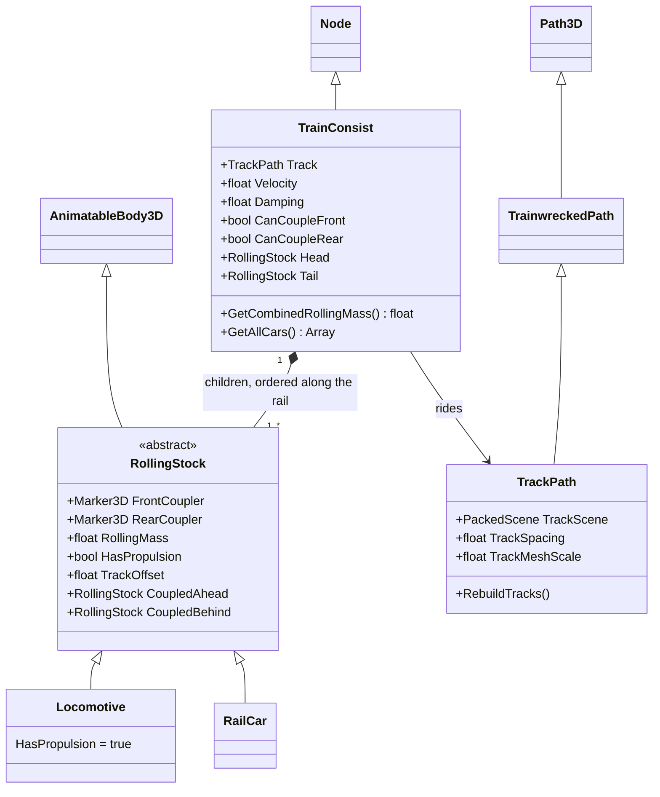

# Rolling stock

`RollingStock` is the shared base for every locomotive and railcar. `RailCar` and `Locomotive` are the only subclasses. `TrainConsist` is a `Node` that parents one chain and steps it along a `TrackPath`. Child order is the chain: child 0 is `Head` and the last child is `Tail`. A lone railcar is a `TrainConsist` with one child. Coupler flags live on the consist. A caboose consist sets `CanCoupleRear` to false.

`RollingStock` is an `AnimatableBody3D`. It exports the front and rear coupler markers and `RollingMass` (default `1`). `HasPropulsion` defaults to false. `TrackOffset` is the baked arc length of the car origin on the consist's track. `CoupledAhead` and `CoupledBehind` are neighbor fields; the consist does not write them. The chain is the child list.

`Locomotive` sets `HasPropulsion` in `_Ready`. It has no power-source subclasses and does not apply force.

`RailCar` adds no fields. It has no subclasses.

`TrainConsist` only simulates on the server. `_Ready` requires a positive combined mass, captures `Head` and `Tail` once, and snaps the chain onto `Track`. Those end references are not refreshed if the child list changes. A child that is not `RollingStock` is warned and ignored.

Snapping projects each car onto the closest baked offset, then rewrites offsets so adjacent coupler markers meet while the chain's average offset stays put. Child `i` sits ahead of child `i + 1` along increasing offset. The path pose points local `-Z` that way, and each coupler's arc is the marker's local `-Z`. A missing marker counts as the car origin. The whole chain then shifts so both coupler extremes lie on the baked curve. A chain longer than the curve throws.

Each physics frame damps `Velocity` by `exp(-Damping * delta / mass)`, where mass is the sum of member `RollingMass`. A heavier consist coasts longer. `Damping` of `0` leaves velocity unchanged. The same arc step is then added to every `TrackOffset`, shortened so the outermost coupler cannot pass either end of the curve. `Velocity` is cleared when the chain is already against the end it is moving toward. Each car is placed from its own offset. The host sends those poses to clients, which apply them and do not step the chain.

`CanCoupleFront` and `CanCoupleRear` record whether another consist may join that end. The physics step does not read them. There is no insert, split, or propel method.
